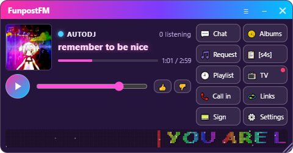
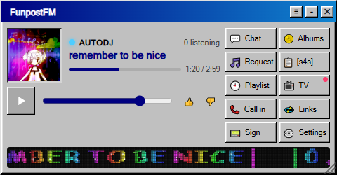
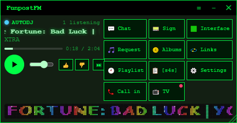
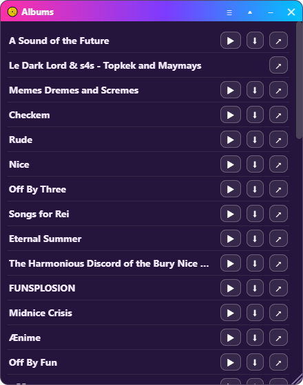
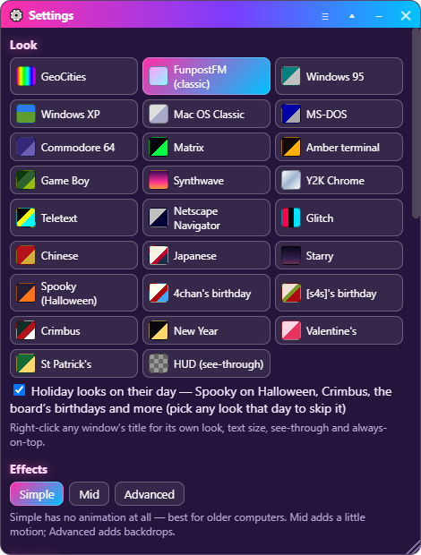
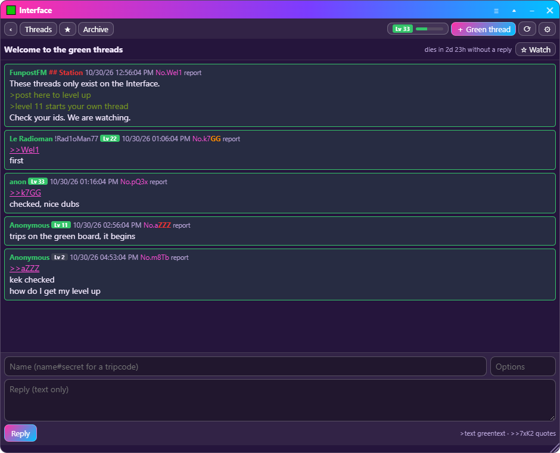
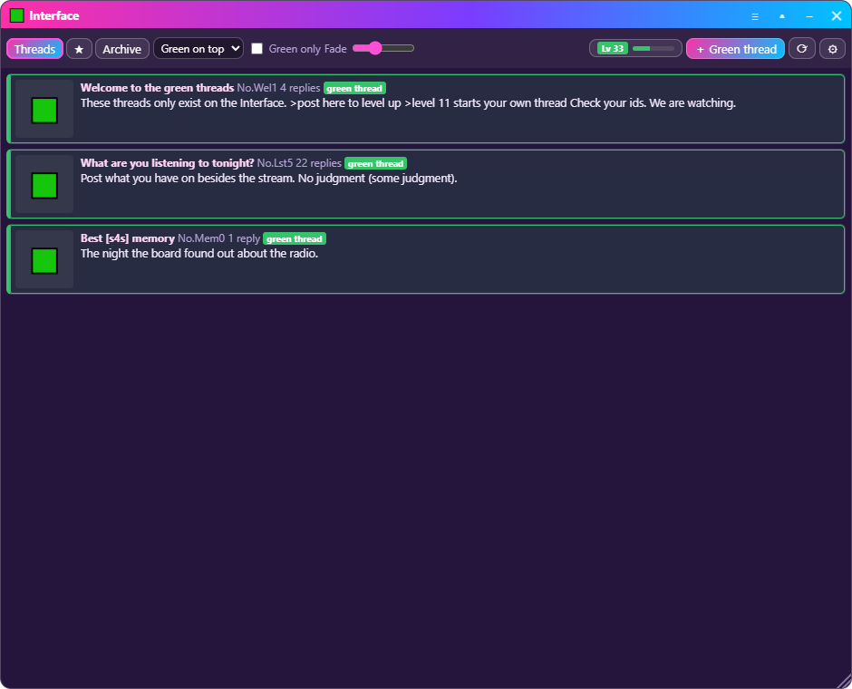
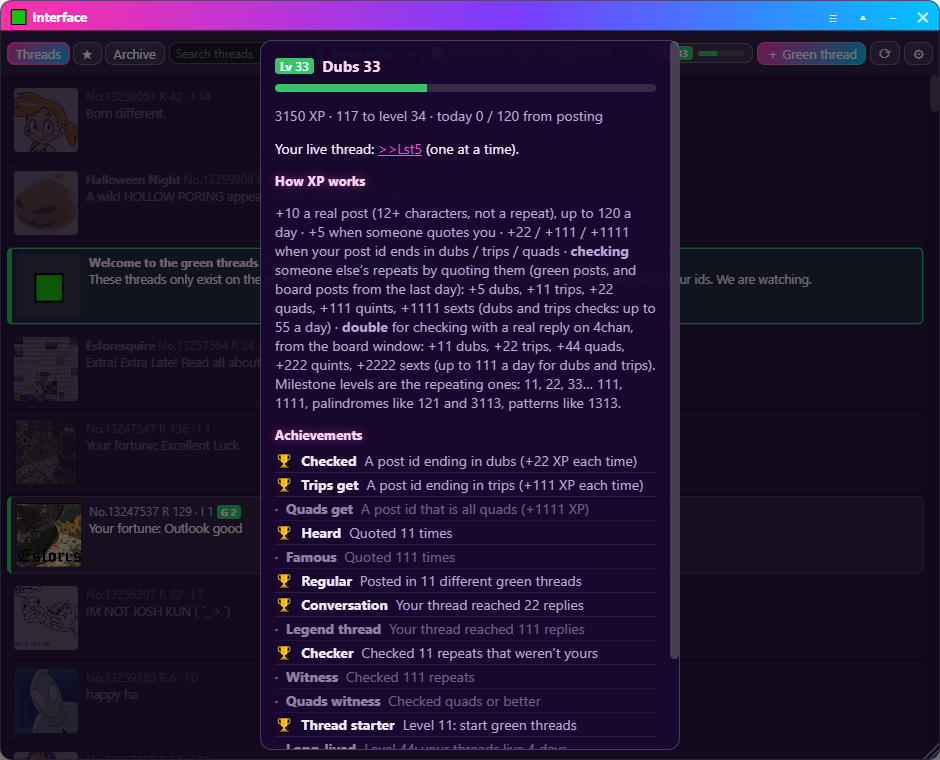

<div align="center">

# 📻 On Air

**FunpostFM on your desktop — a small radio with everything the station offers, and a secret for [s4s].**

[](https://github.com/blastlaster/on-air/releases/latest)
[](https://github.com/blastlaster/on-air/releases)

[](LICENSE)



**[⬇ Windows](https://github.com/blastlaster/on-air/releases/latest/download/On-Air-Setup.exe)** ·
**[⬇ Linux AppImage](https://github.com/blastlaster/on-air/releases/latest/download/On-Air-x86_64.AppImage)** ·
**[⬇ Linux .deb](https://github.com/blastlaster/on-air/releases/latest/download/On-Air-amd64.deb)** ·
[Listen to FunpostFM](https://esfores.neocities.org/)

</div>

---

On Air is the desktop app for **FunpostFM** (and any station built the same
way): keep the station on your desktop, get pinged when a show starts, call
in, request songs, play the albums — and do things a web page can't.

## 📻 The desktop app

> Light enough for an old PC. The only sound it ever makes is the live ping.

<table><tr>
<td></td>
<td></td>
</tr></table>

- **📣 A ping when the station goes live** — and whenever the host presses 📣 Ping, live or not. No account, no push service: the app watches the station itself.
- **🗂️ Every part in its own window.** Chat, Request, Playlist, Call in, Sign, Albums, Board, TV, Links, Settings. Move them, size them, roll them up to their title bar, tuck them into the radio, keep any of them on top. They remember where they were, and bringing the radio forward brings them all with it.
- **🎨 18 looks**, per window if you like: the FunpostFM classic plus Windows 95, XP, Mac OS, DOS, Commodore 64, Matrix, Amber, Game Boy, GeoCities, Synthwave, Y2K, Teletext, Netscape, Glitch, Chinese, Japanese and Starry — and a see-through **HUD** that leaves only the words.
- **📞 Call the show** or leave a voicemail, right from the desktop.
- **📀 Albums**: play them in the app or download them to a folder.
- **📋 The board** as a real browser view — the captcha works, so you can post — with your own **userscripts** (Tampermonkey-style).
- **🔄 Updates itself** from this repository's releases; you choose when to restart.

<table><tr>
<td></td>
<td></td>
</tr></table>

**Get it:** [Windows](https://github.com/blastlaster/on-air/releases/latest/download/On-Air-Setup.exe) ·
[Linux AppImage](https://github.com/blastlaster/on-air/releases/latest/download/On-Air-x86_64.AppImage) ·
[Linux .deb](https://github.com/blastlaster/on-air/releases/latest/download/On-Air-amd64.deb).
Windows will say *"Windows protected your PC"* the first time — the app isn't
code-signed yet — click **More info → Run anyway**.

➡ **[The full guide to the app](docs/desktop-app.md)**

---

## 🟩 The Interface

*The problem is that you probably aren't seeing all the posts.*

Click the radio, type **`interface`**, and a new button appears. Behind it is
the board as the community actually sees it: the green posts woven into
[s4s]'s threads, and the community's own **green threads** — numberless,
with letters in their ids — that exist nowhere else.



- **Everything without green fades into the background; green pops out.** Sort green to the top, or show green only.
- **Green threads**: text only, quoted like `>>7xK2`, bumped by replies, archived after three days without one.
- **Levels.** You earn XP by posting, by being quoted, by landing repeating ids — and by **checking** other people's: dubs, trips, quads and up, in green threads *and* on the board itself. Level **11** lets you start a thread of your own (one at a time). The milestones are the numbers [s4s] cares about: **11, 22, 33… 111, 1111**, palindromes like **3113**, patterns like **1313**.
- **(You)**, a watcher for threads, quote previews, tripcodes, and moderation tools for the station.

Green threads are hosted by the station; they're there whenever the station is on.

<table><tr>
<td></td>
<td></td>
</tr></table>

➡ **[Everything about the Interface, levels and checks](docs/interface.md)**

---

## 🛠️ Build it yourself

**The app** (any Windows or Linux machine with Node.js 22):

```bash
cd app
npm install
npm start                 # run it
npm test
npm run dist:linux        # AppImage + .deb in app/dist (on Linux)
npm run dist:win          # On-Air-Setup.exe in app/dist (on Windows)
```

**A station of your own:** this repository is the app only. [CLAUDE.md](CLAUDE.md)
describes everything the app expects from a station backend — point Claude
Code at this folder and ask it to build one around your own station; it asks
for your details as it goes.

**Releasing:** bump `version` in `app/package.json`, commit, and push a tag
like `v0.4.2`. GitHub Actions builds Windows and Linux and publishes the
release, and every installed app updates itself from it.

---

## 🔒 Privacy and safety, plainly

- The app's pages are sandboxed; other sites open in your browser. Only the app's own pages may use the microphone, and only for calls and voicemail.
- Your Interface level follows a private key the app makes for you; it's never shown or put in a link.
- Board userscripts run only in the board's own view and can only reach the sites they declare.

## License

[AGPL-3.0](LICENSE). Use it and change it — and if you share a changed
version with other people, share your changes too.

<div align="center"><sub>Made for FunpostFM and [s4s]. Check'em.</sub></div>
