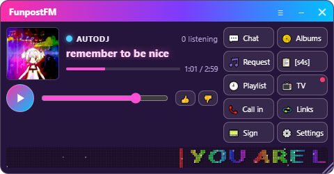
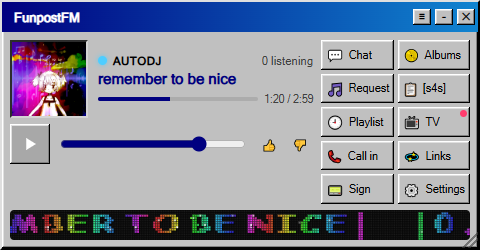
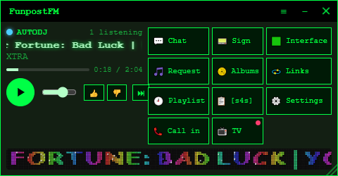
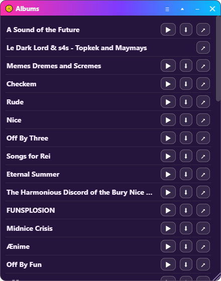
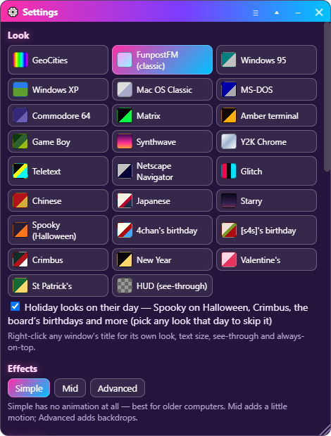

# 📻 The On Air desktop app

[← Back to the overview](../README.md) · [The Interface](interface.md)

The radio on your desktop. A small player is the main window; everything else
the station offers is its own window that you open from the radio's buttons
and arrange however suits you. Built for FunpostFM.



**Contents:** [Install](#install) · [The radio](#the-radio) · [The windows](#the-windows) · [Moving things around](#moving-things-around) ·
[Looks](#looks-text-size-and-effects) · [Live alerts and pings](#live-alerts-and-pings) · [The board](#the-board-and-its-scripts) ·
[Albums](#albums) · [Settings](#settings) · [The tray](#the-tray) · [Updates](#updates) · [For stations: extras.json](#for-stations-extrasjson) ·
[Privacy](#privacy-and-safety) · [Trouble?](#trouble)

---

## Install

| | |
|---|---|
| **Windows** | [On-Air-Setup.exe](https://github.com/blastlaster/on-air/releases/latest/download/On-Air-Setup.exe). Windows says *"Windows protected your PC"* the first time because the app isn't code-signed yet: **More info → Run anyway**. It installs for you only, no admin needed. |
| **Linux** | [AppImage](https://github.com/blastlaster/on-air/releases/latest/download/On-Air-x86_64.AppImage) (make it executable and run it; it updates itself) or [.deb](https://github.com/blastlaster/on-air/releases/latest/download/On-Air-amd64.deb) for Debian/Ubuntu (`sudo apt install ./On-Air-amd64.deb`; it tells you when there's a new one). |
| **Build it** | Any Linux or Windows with Node.js 22: `cd app && npm install && npm start`. See the [developer notes](../app/README.md). |

The first time, paste the station's address — the page listeners open, like
`esfores.neocities.org` — and the radio appears. **Stations…** in the tray
adds more, switches between them, and sets each one's icon.

## The radio

- **Now playing**: the live light (red when someone is live, blue for AutoDJ),
  who is on, how many are listening, the song, its cover, and how far into it.
- **▶ / ⏸** and the volume. **👍 / 👎** vote on AutoDJ songs from the station's library.
- **⏭ Skip vote** (when the station allows it, and its PC is on): when more than half of the people listening press ⏭, the AutoDJ song is skipped. A bar under the volume shows everyone how close a vote is.
- A song title too long for the radio scrolls by.
- An **📀 album** you're playing, or a **📞 call** you're on, gets a line of its own with its controls.
- The **LED sign** runs along the bottom (Settings can move it to its own window).
- A button for each window. Press once to open, again to tuck it away, again to
  bring it back where it was. A lit button is open; a dot means news (new chat,
  the video stream is live).

The media keys on your keyboard play and pause.

## The windows

| Button | Window |
|---|---|
| 💬 **Chat** | The live room during a show (the station's own chat), the community's Chattable room the rest of the time — in the app's look, under the name you set. |
| 🎵 **Request** | The station's music: search and request — from the DJ's library when live, from AutoDJ's otherwise. |
| 🕘 **Playlist** | Coming up next, and what just played. |
| 📞 **Call in** | Call the show (it asks first — you'll be live), leave a voicemail, check in with a guest code, and see who's on the line. |
| 📟 **Sign** | The LED sign as its own strip — park it across the top of your screen. |
| 📀 **Albums** | Play the station's albums in the app, or download them. |
| 📋 **Board** | The station's board as a real browser view, behind an 18+ warning. |
| 📺 **TV** | The station's video stream while it's live (the button pulses); its channel in your browser otherwise. |
| 💫 **Links** | The station's friends. |
| ⚙️ **Settings** | Everything below. |
| 🟩 **Interface** | *Hidden.* [How to find it](interface.md). |

## Moving things around

Every window can be:

- **moved** by its title bar and **resized** by the corner grip;
- **rolled up** to its title bar (▴) and rolled down again;
- **tucked** back into the radio (–) — its button brings it back where it was;
- **closed** (✕).

Right-click a title bar (or press **≡**) for that window's own **look, text
size, see-through and always-on-top**. Windows remember where they were and
reopen with the app. **Minimising the radio tucks them all away**, and
restoring it brings them back; **bringing the radio forward brings them all
forward** with it. Lost one off a screen that's gone? Tray → **Put the windows
back on screen**.

## Looks, text size and effects

<table><tr>
<td></td>
<td></td>
</tr></table>

25 looks — the FunpostFM classic, Windows 95, Windows XP, Mac OS Classic,
MS-DOS, Commodore 64, Matrix, Amber terminal, Game Boy, GeoCities, Synthwave,
Y2K Chrome, Teletext, Netscape Navigator, Glitch, Chinese, Japanese, Starry and
the seven holiday looks below —
plus **HUD**, which leaves only the words over whatever is behind the window.
Set one for the whole app (Settings) or per window (right-click its title). The
chat room follows the look too.

**Holiday looks** — the board's rare one-day themes, any day you want them:

| Look | Its day | In the app |
|---|---|---|
| 🎃 **Spooky** | Halloween, Oct 31 | 4chan's Halloween colours, a dancing skeleton in every title bar; bats on Advanced |
| 🎉 **4chan's birthday** | Oct 1 | Yotsuba with party hats on the windows; confetti on Mid |
| 🎉 **[s4s]'s birthday** | Apr 1 — the board that started as a joke | Yotsuba in Comic Sans, a rainbow bar, party hats; confetti on Mid |
| 🎄 **Crimbus** | Dec 24–25 | Lights along the title bars; snow on Mid |
| ✨ **New Year** | Jan 1 | Black and gold; sparkles on Mid |
| 💘 **Valentine's** | Feb 14 | Pink; floating hearts on Mid |
| ☘️ **St Patrick's** | Mar 17 | The greenest day; falling shamrocks on Mid |

On its day the app wears the holiday by itself (windows with their own look
keep it) and says so once. Pick any look that day to skip it, or switch
**Holiday looks on their day** off in Settings.

**Effects** are off unless you ask: *Simple* has no animation at all (best for
older computers), *Mid* adds a little motion, *Advanced* adds backdrops.
**Text size**: Small, Normal, Large, Larger.

The app is light on purpose: every window shares the radio's one process and
one connection to the station, and a window that isn't open costs nothing.

## Live alerts and pings

The app tells you, with a notification and a sound — **the only sound it ever
makes** —

- when the station **goes live** (once per show), and
- whenever the host presses **📣 Ping** in the studio, live or not.

There's no account and no push service: the app watches the station itself
(at once while the radio is connected to the studio, otherwise every 30
seconds). Click the notification to start listening. It works with the app
closed to the tray — tick **Start with the computer** and it stays there,
quietly. Switch alerts off in Settings or the tray.

**On Windows, check that pop-ups are allowed** — Windows can hide every app's
notifications, and then the ping arrives but never shows:

1. Open **Settings → System → Notifications** (Windows 10: *Notifications & actions*).
2. Turn on **Get notifications from apps and other senders**.
3. In the list below it, make sure **On Air** is on (it appears after the first alert).
4. Turn off **Focus assist** (Windows 10) or **Do not disturb** (Windows 11), or add On Air to its priority list.

## The board and its scripts

The board opens in a real browser view, so the site sees an ordinary visit:
its **captcha works and you can post**. It keeps its own cookies (separate from
the rest of the app), stays on the board's own site (other links open in your
browser), and can be **tinted** to match the app's look. ‹ ⌂ ⟳ and ↗ (open in
your browser) are along the top.

**Right-click** a picture to save it (under the name it was posted with), copy
it or search for it; right-click links and the reply box as usual.

**"Your IP range is blocked… verify your e-mail"?** The board window keeps its
own cookies, so verifying in your browser doesn't count here. The window
notices 4chan's message and walks you through it (or press **🔗**):

1. Press **Start**, click **verify your e-mail address** in 4chan's message, and enter your e-mail.
2. In 4chan's e-mail, **don't click the link**: right-click it → **Copy link**.
3. Come back to the board window: it spots the copied link and opens it there (or press **Paste link**).

**🧩 Scripts** runs Tampermonkey-style userscripts in the board:

1. Paste a Greasy Fork page or a `.user.js` link (or pick one **suggested by the station**).
2. The app shows what it runs on and which sites it talks to. Add it only if you trust it — a script can read and change everything on the board's pages, including what you post.
3. Turn scripts on and off, **Update** them, or remove them. The board reloads by itself.

Scripts run only in the board's view, on the pages their `@match` /
`@include` lines name. `GM_xmlhttpRequest` reaches only the board and the
sites in their `@connect` lines (form uploads, images included), and
`GM_getValue`/`GM_setValue` keep their settings. FunpostFM suggests the
[s4s] interface (green posts, with images), [Better] [s4s] and [s4s] Enhancer.

## Albums



**▶** plays an album in the app (it pauses the radio; ⏮ ⏭ ✕ on the radio's
album line). **⬇** downloads it to `Music\<station>\<album>`: from archive.org,
the uploader's own files, one format per track — MP3, or lossless if you ask —
and the cover. **↗** opens its page (Bandcamp, YouTube…). Settings picks the
folder, or asks each time.

## Settings



| Section | |
|---|---|
| **Look** | The app's look (each window can have its own). |
| **Effects** | Simple, Mid, Advanced. |
| **Text size** | Small to Larger. |
| **Windows** | Which windows exist at all (switched off, its button leaves the radio); new windows on top of other programs; minimising the radio tucks the others away; the LED sign in the radio; buttons on the left; the board's 18+ warning. |
| **Updates** | Get new versions by themselves; *Check now*; *Restart to update* when one is ready; release notes. |
| **Alerts** | Live alerts and pings; start with the computer, quietly in the tray. |
| **Album downloads** | The folder; ask each time; lossless when available. |
| **You** | Your name — used in chat, on calls, and in the community chat room. |
| **Station** | Which station, and **Stations…** to add, switch or set icons. |

## The tray

Click the tray icon to open the radio; right-click for the station, who's on
and the song, **Play/Pause**, **Reload**, **Live alerts**, **Start with the
computer**, updates, **Put the windows back on screen**, **Stations…** and
**Quit**. The icon carries the station's own picture with a dot: red when live,
blue for AutoDJ.

## Updates

The app checks this repository's releases a minute after it starts and every
six hours. A new version downloads quietly; a notification and the tray then
offer **Restart to update**, and On Air comes back on the new version by
itself. Quitting installs it too: the new version then opens with a short
note — **Open On Air** or **Close**. On a Linux `.deb`
the notification links to the download instead. Settings → Updates switches
this off.

## For stations: extras.json

The radio, chat, requests, call-in and the sign come from the station itself.
Albums, links, a board, a video channel and suggested board scripts come from
a small file published next to `station.json` (`onair/extras.json`):

```json
{
  "chattable": "room",
  "albums": { "items": [
    { "title": "An album on archive.org", "archive": "its-identifier" },
    { "title": "Somewhere else", "tracks": [{ "title": "One", "url": "https://…/1.mp3" }], "download": "https://…/album.zip" },
    { "title": "A link only", "page": "https://…bandcamp.com/album/…" }
  ] },
  "links": [{ "title": "Frens", "items": [{ "title": "A site", "url": "https://…" }] }],
  "board": { "title": "[s4s]", "url": "https://boards.4chan.org/s4s/", "nsfw": true,
             "scripts": [{ "title": "A script", "about": "What it adds", "url": "https://greasyfork.org/scripts/…" }] },
  "tv": { "channel": "https://www.youtube.com/@…" }
}
```

`albums` may instead be `{ "url": "https://your-server/albums.json" }`, in the
same shape. Green threads are served by the station PC with nothing to add; a
station that runs them elsewhere names it as
`"board": { …, "interface": { "server": "https://…" } }`.

## Privacy and safety

- The app's own pages run sandboxed with no access to your computer; links to other sites open in your browser.
- Only the app's own pages may use the microphone — for calls and voicemail — and only for audio.
- The board keeps its own cookies, apart from the rest of the app.
- Your Interface level follows a private key the app makes for you. It goes only to the station's green threads, never into a page or a link.

## Trouble?

| | |
|---|---|
| **No pop-ups for pings** | Windows: Settings → System → Notifications → **Get notifications from apps and other senders** on, **On Air** on, Focus assist / Do not disturb off ([details](#live-alerts-and-pings)). Check Settings → Alerts in the app. |
| **"Windows protected your PC"** | More info → Run anyway (the app isn't code-signed yet). |
| **A window is off-screen** | Tray → Put the windows back on screen. |
| **The board looks stuck** | ⟳ in its bar, or tray → Reload. |
| **4chan says my IP range is blocked** | Verify your e-mail in the board window itself: **🔗** → Start, then copy (don't click) the link in 4chan's e-mail ([details](#the-board-and-its-scripts)). |
| **Green threads say offline** | The station's PC is off; the board and its green posts still show. |
