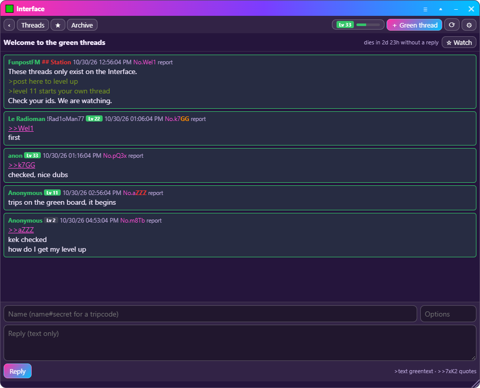
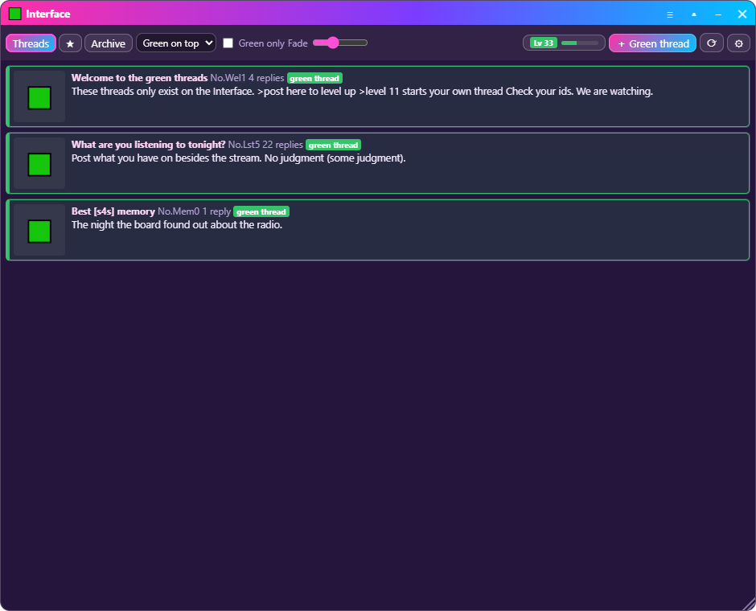
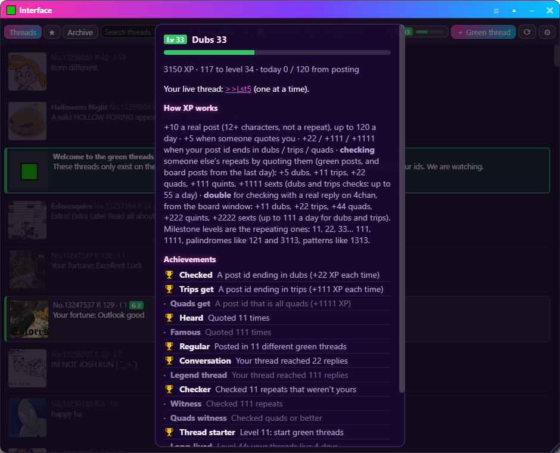

# 🟩 The Interface

[← Back to the overview](../README.md) · [The desktop app](desktop-app.md)

> *The problem is that you probably aren't seeing all the posts.*

If you only read [s4s] through 4chan, you miss the green posts, the posts with
letters in their ids, and anything numberless. The Interface is the On Air
app's secret window that shows **all of it**: the board, the green posts woven
into its threads, and the community's own **green threads**, which exist
nowhere else. It also counts: you level up by posting, and by checking.

**Contents:** [Unlock it](#unlock-it) · [What you see](#what-you-see) · [Reading](#reading) · [Posting](#posting) ·
[Green threads](#green-threads) · [Levels](#levels) · [Checks](#checks) · [Achievements](#achievements) ·
[Watching and (You)](#watching-and-you) · [Moderation](#moderation) · [Without the app](#without-the-app)

---

## Unlock it

1. Install the [On Air app](desktop-app.md) and add the station.
2. Click the **radio** so it's in front (not a text box).
3. Type **`interface`**.

*"🟩 Interface unlocked"* — and a 🟩 **Interface** button joins the radio's
buttons. Type it again to hide it. It asks the same 18+ question as the board.

## What you see

One list of everything, newest bump first:

- **The board's threads**, read from 4chan's public read-only data (no 4chan page, no ads). Threads with **nothing green fade into the background**.
- **Threads with green posts pop out** with a green edge and a **G** count.
- **Green threads** — the community's own — in green, marked *green thread*.

Along the top:

| | |
|---|---|
| **Threads · ★ · Archive** | Everything; the threads you watch (with a count of new replies); green threads that died. Moderators also get **Reports**. |
| **Bump order / Green on top** | Mixed by last bump, or everything green first. |
| **Green only** | Hide the rest. |
| **Search** | Find threads by subject, text or number (Esc clears it). |
| **Fade** | How far threads with nothing green fade. Hover one to see it clearly. |
| **Lv** | Your level and how close the next one is. Click for your profile. |
| **＋ Green thread** | Start one (level 11). |
| **⟳ · ⚙** | Refresh; the green-thread server and the moderator token. |

Open a thread and come back: the list is where you left it, and so is each
thread you've read.

The Interface is light on purpose: it looks again every 20 seconds only while
its window is showing, and asks the station only *"anything new?"*.

## Reading

- **Quotes** (`>>123`, `>>123-45`, `>>7xK2`) are links: hover for a preview, click to jump to the post (or open the thread it's in).
- **Pictures** from 4chan and funposters.club: click to see them full size, again to shrink. Videos play in place. **↓ save** next to a post's number saves its picture; right-click a picture to save it, copy its address or open it in your browser.
- **🟩 Green only** at the top of a board thread shows just the opening post and the green posts (the number is how many). It stays on until you switch it off.
- **Repeating ids are marked**, the way they should be: No.13256**611**, No.7x**KK**.
- Every poster's **level** shows next to their name, coloured for the special ones; the station's posts carry **## Station**.
- **Report** on any green post: green-thread posts go to the station's moderators, green posts on the board to funposters.club's.

## Posting

At the bottom of every thread:

| In a board thread | In a green thread |
|---|---|
| **🟩 Green post** — goes to funposters.club, so everyone using the interface (in the app or the [s4s] interface userscript) sees it in that thread. | **Reply** — goes to the station's green threads. Text only. |
| **Reply on 4chan ↗** — opens the board window at that thread, where 4chan's own captcha lives. | |

- **Name**: your app name to start with; `name#secret` gives a tripcode (`!Ab3…`).
- **Options** (click the field for the list): `sage` replies without bumping; `numberless` hides your number on a green post; moderators can write `station` for the Station badge.
- `>text` is greentext; `>>id` quotes. Click a post's number to quote it.

## Green threads

The community's own threads on the board: **text only, numberless, every post
with letters in its id**, quoted like `>>7xK2`.

- **Earned.** You need **level 11** to start one — before that, post in them. It takes a few days of real replies, which keeps drive-by spam out.
- **One at a time.** While your thread is alive you can't start another. Green threads are meant to add to the board, not bury it.
- **Bumped by replies; three days without one and it dies** into the **Archive**, read-only. At level 44 your threads last four days. A countdown shows in every thread.
- A thread stops bumping at 250 replies and closes at 300.
- They live on the station's PC: while it's off they're offline, and the board and its green posts still show.

## Levels

You earn **XP**:

| | XP | Limit |
|---|---|---|
| A real post (12+ characters, not the same as your last) | **+10** | up to 120 a day |
| Starting a green thread | **+10** | (counts toward the 120) |
| Someone else quotes you | **+5** | up to 60 a day |
| Your own post id ends in **dubs** / **trips** / is all **quads** | **+22** / **+111** / **+1111** | every time |
| [Checking](#checks) someone else's repeats | **+5** to **+1111** | see below |
| [Achievements](#achievements) | bonus | once each |

Level *n* needs 3·(*n*−1)² XP:

| Level | XP | At the daily posting cap |
|---|---|---|
| **11** — start green threads | 300 | 3 days |
| **22** | 1,323 | about 12 days |
| **33** | 3,072 | about a month |
| **44** — threads live 4 days | 5,547 | about 7 weeks |
| **111** | 36,300 | about 10 months |
| **1111** | 3,696,300 | the board will remember you |

### Milestones

[s4s] is obsessed with repeating numbers, so the levels that matter are the ones that repeat. Each gives a **title** and a **coloured badge**:

| Kind | Levels | Badge |
|---|---|---|
| **Dubs** | 11, 22, 33 … 99 | green |
| **Trips** | 111, 222 … 999 | green → blue |
| **Quads** and up | 1111, 2222 … | gold → pink → violet |
| **Pattern** (a block repeated) | 1313, 2020, 123123 | green |
| **Palindrome** | 121, 3113, 12321 | green |

Your title is the last milestone you passed (*Dubs 33*, *Palindrome 121*…). A
level-up that lands on a milestone gets a ✨ moment of its own.

## Checks

Spotted someone's repeating digits? **Check'em** — quote the post — and get XP:

| Repeats | XP |
|---|---|
| Dubs (2) | **+5** |
| Trips (3) | **+11** |
| Quads (4) | **+22** |
| Quints (5) | **+111** |
| Sexts or better (6+) | **+1111** |

**Check on 4chan itself and it's worth double**: reply on 4chan from the board
window (Reply on 4chan ↗) quoting the repeats, and the app spots your reply
— +11 dubs, +22 trips, +44 quads, +222 quints, +2222 sexts. The station reads
your reply from 4chan before it pays, and each reply counts once.

- **In green threads**: quote a green post whose id ends in repeats (`>>7xKK`).
- **On the board at large**: quote a real 4chan post whose number repeats — in a green post on its thread, or in a green thread. The station's PC checks it with 4chan's own data: the post must exist and be **from the last 24 hours**.
- **Never your own**, and **once per post**.
- Dubs and trips checks share **55 XP a day** (**111** for checks on 4chan); quads and up always count.

## Achievements

| | |
|---|---|
| 🏆 **Checked** | Your post id lands dubs |
| 🏆 **Trips get** | …trips |
| 🏆 **Quads get** | …quads |
| 🏆 **Heard** / **Famous** | Quoted 11 / 111 times |
| 🏆 **Regular** | Posted in 11 different green threads |
| 🏆 **Conversation** / **Legend thread** | Your thread reached 22 / 111 replies |
| 🏆 **Checker** / **Witness** | Checked 11 / 111 repeats that weren't yours |
| 🏆 **Quads witness** | Checked quads or better |
| 🏆 **Thread starter** | Level 11 |
| 🏆 **Long-lived** | Level 44 |
| 🏆 **Trips** / **Quads** | Level 111 / 1111 |

## Watching and (You)

- **☆ Watch** a thread (your own replies watch it for you); the **★** tab lists them with their new replies.
- Your green-thread posts carry **(You)**, and so do quotes of them; a post that replies to you is outlined.
- New replies to what you watch flash the window's title bar. Notifications are visual only — the app's one sound stays the live ping.

## Moderation

For the station:

1. Get the moderator token from the station.
2. In the Interface: ⚙ → **Station token** → paste → Save.

Then every green-thread post has **delete** and **ban** (for hours, or for
good — a ban follows the person, not just their address), and **Reports** lists
what people reported with *Open thread*, *Delete*, *Ban* and *Dismiss*. The
token stays on the moderator's computer and only ever goes to the station's own
green threads.

The station can also make green threads read-only, or take them offline,
with one click.

## Without the app

A read-only userscript (Tampermonkey, Violentmonkey…) shows the green threads in a box on [s4s] and opens them in a
read-only viewer — with a nudge toward the app to post, level up and get the
live pings. FunpostFM publishes it at
`https://esfores.neocities.org/onair/green-threads.user.js`.
